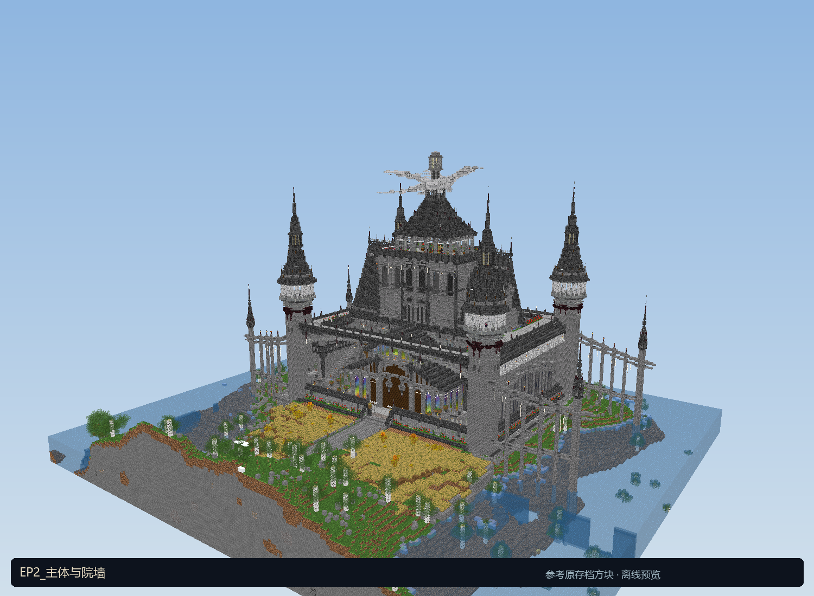
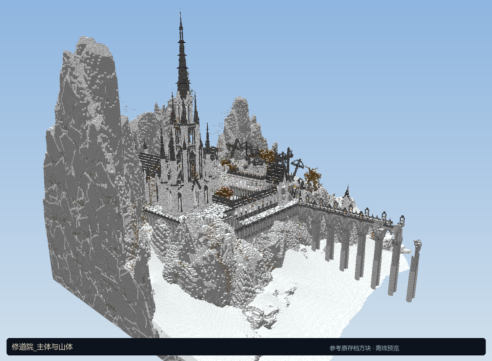

# 两份建筑参考：实际构件研习

最新补充：塔顶移植与旧塔身的组合均遭用户否决，后续依据已更新到[四个教学视频研习与返工依据](四个教学视频研习与返工依据.md)。本文保留最初的存档研习事实，不能把它当作现有建筑效果已经达标的证据。

2026-11-01。用户提供 EP2_by_可丽饼_ 和《长眠者的圣维蕾娜修道院》，明确用途是学习细节、建筑方法，不是要求仿建。现有城堡仍沿已认可的梦核欧式哥特方向及阶段六构图继续。

本次直接读取两份存档的区块与方块状态，先定位主体，再查看整体、屋顶连接和近处立面。没有启动、升级或改写参考存档，也没有把其结构导入自己的世界。下述“做法”来自实际方块；“应用”是本城堡下一步的施工方向，两者分开记录。

## EP2：构件怎样层层相接

**塔顶有完整的过渡过程。** 角塔不是一根筒直接接一个锥体。塔身之上先有挑出的承托与腰带，再是浅色开敞观景层、扩出的檐边、深色坡顶、顶部小窗段，最后才收成细尖。各段宽度交替，远看仍分得清部件。屋面还有楼梯边线、小突起和细顶饰，坡面没有一直沿单一斜率收上去。

可追溯样本：东南角塔中心约 `(51,652)`，以下为该塔相应高度的平面外包络，不是内部净宽。

| 高度 Y | X/Z 方向外包络宽度 | 观察到的部件与用块 |
|---|---:|---|
| 154 | 11×11 | 石砖、磨制安山岩半砖/楼梯组成的水平承接 |
| 158、162 | 13×13 | 磨制闪长岩、墙、铁栏杆、末地烛组成的开敞浅色层 |
| 166 | 15×15 | 再次挑出的檐边，带深色墙和楼梯 |
| 170 | 9×9 | 深色屋面收进 |
| 178 | 5×5 | 深板岩墙、黑色玻璃与光源组成的小窗段 |
| 186 | 3×3 | 细化的顶部过渡 |
| 190、194、198 | 1×1 | 方块、墙、栅栏继续收尖 |

这是值得学习的“宽窄节奏”；不会照搬其角塔外形或尺度。

**屋顶与墙体共享一套边界。** 侧坡顶有加厚的下缘，端头回到竖向边柱；中央较高主体、较低两翼与顶部开敞层的关系清楚。应学习完整的檐下承接、山墙边线与墙角收口，而非只把屋面向下延长一格。

**窗和墙有深度差。** 深色细竖线及凹入的玻璃，衬出浅色窗边；实墙、窄窗、横向腰线交替。彩玻璃被石质窗棂和外框分隔，颜色服从窗的结构。我们的彩窗应先确定完整的石质分格，再在各分区安排主色，减少大面积无主次的彩色格子。

**外部空间也按部件组织。** 院墙、上部可行走带、桥、花带和正门轴线互相对应。值得学的是景观与建筑开间的对齐，以及一段段有端头、有转角收口的连续构件。

[屋顶与塔身连接近景](EP2_屋顶与塔身交接.png) · [正立面近景](EP2_正立面与塔脚.png) · [主体坐标](EP2_主体坐标.png)

## 修道院：细柱、深凹槽与连续装饰

**高塔靠竖向骨架与内退层次站住。** 高而窄的开口被突出附柱、较暗的内层和小横档分开。白色构件并非一样粗、一样亮地并排摆放；粗柱与细线、连续竖线与横向托座有明确主次。高塔底部较厚，上部逐渐变细，周围较小尖塔辅佐主塔。

**精细感有一部分来自实际截面。** 存档中大量使用墙、正放及倒放楼梯、半砖、铁砧、炼药锅、漏斗、铁栏杆等。这些方块提供窄颈、空腔、薄沿和悬挑，不能以同位置的完整方块替代后还声称细节一致。学习时需要看它们放在哪一层、朝向哪里、与相邻块形成什么轮廓。

一个具体样本是东侧庭院檐边 `(x63..69, y29..34, z-90..-40)`：存在连续的磨制闪长岩正/倒楼梯、半砖、深板岩砖与漏斗。取 `z=-65` 的局部截面：

| 位置 | 实际方块 |
|---|---|
| `(67,30,-65)` | 倒放磨制闪长岩楼梯，朝北 |
| `(67,31,-65)` | 倒放磨制闪长岩楼梯，朝东 |
| `(67,32,-65)` | 磨制闪长岩整块 |
| `(66,32,-65)` | 向外侧伸出的漏斗截面 |
| `(67,33,-65)` | 正放磨制闪长岩楼梯，朝西 |
| `(66,33,-65)` | 深板岩砖 |

这说明细部是上下、内外共同组成的截面，不只是墙面贴一条装饰。具体构件用途的名称属于观察解释，不冒称作者的设计说明。

**装饰依附于结构节奏。** 小尖饰、栏杆、托座沿开间重复，但主塔、桥头和转角有更强的结束部件。不能把“密”理解成每一面墙都均匀撒同样的碎块。大面负责安静，窗边、柱头、檐口与轮廓负责聚集细节。

**地形参与构图。** 细长高塔、较低院落、长桥和更高的山体形成不同尺度，桥下留白让高差更清楚。我们的项目可学习台地与桥廊的高差关系，继续保留自己的静水、浅色石材和梦核空旷感。

[塔脚与立面近景](修道院_入口与立面.png) · [侧立面细节](修道院_侧立面细节.png) · [主体坐标](修道院_主体坐标.png)

## 对现有梦核城堡的应用顺序

当前世界仍为 **梦核哥特_层叠水庭与瀑布拱桥_20261031**。本次是参考研习，没有发布新的城堡存档。

1. **先精修一个现有回廊开间及邻接塔脚。** 将承重束柱、细附柱、窗棂和檐边拉开粗细，补完整柱脚、柱头、内退窗套与转角收口；检查从正面和侧面都成立。做好近处可见的完整单元，再延伸到其他开间。
2. **用连续截面整理屋顶接头。** 从墙体、檐下托座、薄挑檐到屋面下缘逐层相接；转角和山墙端头一起处理。按已有高低轮廓细化屋脊与小窗段，不照搬参考的黑色屋顶或塔型。
3. **重排局部明暗和材质。** 保留浅色梦核基调，使用少量较暗的凹槽、内框、柱间阴影底色与克制的石材变化。深色集中于内退处和细边，避免整栋改黑，也避免整面墙随机撒不同颜色。
4. **让彩窗有清楚的石质分格。** 保护整扇窗的外轮廓及窗棂，不用新增楼板、桥口或柱头切断它；保留已认可的玫瑰窗作为主角。
5. **将装饰与通路一起检查。** 新托座、栏杆和窗台不能挡住原路线。漏斗这类有方块实体的构件只在有必要时少量使用，优先用合法原版楼梯、半砖和墙取得合适的截面，不把参考中的用块数量当成目标。

现有离线图的简单光照会压平部分阴影，不能代替游戏画面对最终明暗的判断；但构件粗细、实际进退、断口及同材质比例可以直接由方块坐标核对。后续效果仍应以保存后的实际建筑审阅为准。

## 读取范围与预览说明

- EP2 原目录：`D:/download/EP2_by_可丽饼_/`，元数据版本 1.20.1。已扫描主世界区块定位建筑；三维样本覆盖 x-90..105、y100..245、z550..725，包含周边水土与地形，不把样本方块数称为建筑规模。
- 修道院原压缩包：`D:/download/长眠者的圣维蕾娜修道院.zip`，元数据版本 26.3。只将 level.dat 和主世界 region 文件解到本项目的研习目录供读取，未运行包中内容。整体三维样本覆盖 x-65..220、y-40..190、z-205..65，包含地形；侧立面细节另取 x-10..86、y18..83、z-143..-30，以便观察庭院檐口。图边缘是采样截面，不是原建筑边界。
- 三维图来自实际方块位置与状态，使用 1.21.5 原版方块模型和纹理离线生成，**不是客户端截图，也不是概念图**。没有光影包的照明、阴影和后期效果，透明与光源表现也有近似。
- 修道院含 1.21.5 不具备的方块。红/橙叶树、灌丛用近似植物表现；其余未支持的新方块暂以中性方块占位；EP2 的旧版 `grass` 也存在占位。颜色、体积以原版本为准，不用这些占位形状判断细节优劣，更不直接移入本项目。已支持的楼梯、半砖、墙、栏杆、铁砧、漏斗和炼药锅按原版模型读取；新格式省略的默认状态由本地 1.21.5 方块默认状态补齐。
- 已查看的外部样本足以支持本次构件分析，尚未逐房间走查所有室内，不声称完成了两张地图的全面实机游览。

读取证据、源文件校验、构件剖面和未支持方块清单保存在 `.workbuddy/gothic_reference_study_20261101/`。参考文件内的内容仅作为资料，不作为用户施工指令。
