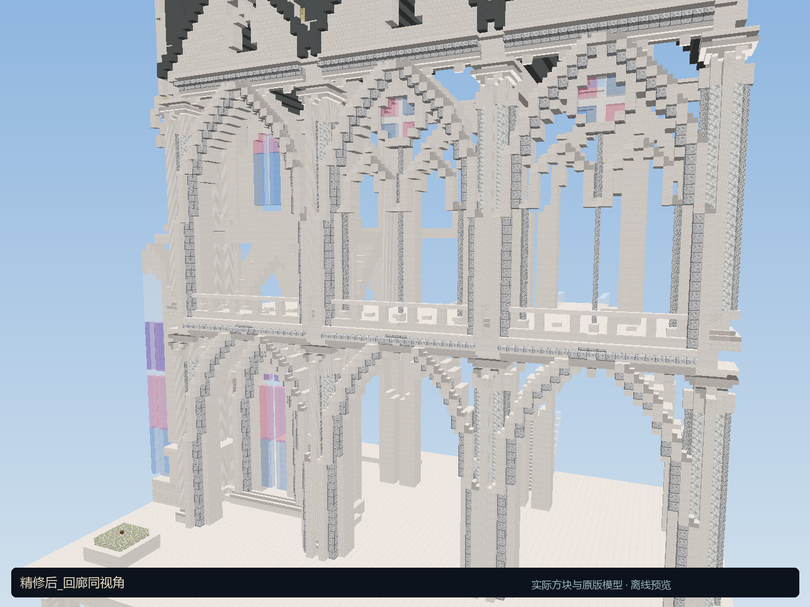

# 回廊与塔脚精修

新独立世界：**梦核哥特_回廊与塔脚精修_20261101**。

本轮在阶段十二当前游戏存档的一致副本上局部施工，保留旧世界及玩家数据。目标仍为 Minecraft Java 1.21.5，不需要原 sweetdream、manacore、资源包或投影模组。创造、正午、原出生点与跌落返回延续原设置；进入不会重建建筑，手工修改可以保存。

## 此次改变

先拆看用户提供的 `EP2_FINAL.litematic` 与 `投稿.litematic`，然后试做一个回廊开间，检查近景后处理正面六个开间、对应柱列及两座入口塔的底层窗套。参考学习记录见 [两份投影补充研习](../建筑参考研习_20261101/两份投影补充研习.md)。没有复制参考的整体建筑或导入其中实体。

**柱子与檐口。** 保留原束柱承重芯，将外贴的整块细柱改为较小的原版墙截面；调整柱脚、柱头的正倒楼梯与半砖。石英、方解石和闪长岩分担主体、转角和细附柱，避免所有部分都是同样粗的白色整块。横向檐口和楼板前缘分层，向外挑出的薄边补有背部承接与托座。

**拱券与窗棂。** 六跨都增加内退浅灰拱套与前缘白色线脚。外侧四跨的上层加入成对开放尖拱窗棂及四扇小圆彩窗，颜色为白、浅蓝和浅粉；下层开口仍可通过。内侧两跨后面有原有塔窗，因此保持上层开口，不放新的中柱和圆窗挡住它们。

**塔脚。** 两座入口塔底层柳叶窗外增加完整双层罩拱、细附柱和薄窗台。窗台与下部连接，外罩避开原有玻璃。原先49组指定彩窗全部保留；本轮增加4组，共53组。

这轮是入口附近的构件精修，范围没有扩大。整座建筑仍沿已确认的梦核浅色哥特方向，主构图、静水与玫瑰窗的主次保留。塔内交通、更多生活空间、外部地形、远景桥网和夜间照明仍有后续工作；本轮不是整座城堡的最终完成或最终美术验收。

## 在游戏里查看

在单人游戏列表选择上面的新世界名称。安装位置：

`D:/PCL 正式版 2.10.0/.minecraft/versions/1.21.5-Fabric 0.16.10/saves/梦核哥特_回廊与塔脚精修_20261101`

出生后向大门走近即可看见两侧回廊。地面从拱下穿过仍通畅；上层沿原楼梯与回廊进入，新增窗棂位于临庭的立面边缘，内侧走道保留。

便于创造模式查看的位置：

```mcfunction
/tp @s 72.5 65 18.5 180 -12
/tp @s 72.5 98 0.5 0 -18
/tp @s 46.5 65 11.5 180 -20
/tp @s -72.5 98 0.5 0 -18
```

依次看右侧下层拱券、右侧上层窗棂与圆窗、右塔底层窗套、左侧上层。上层走道位于窗棂后方；内侧两跨与塔身交汇的地面通路从原窗基座前方绕过。

## 实际预览



[施工前同视角](施工前_同视角.png) · [柱脚与下层拱券](精修后_柱脚与下层拱券.png) · [廊内窗棂与小圆窗](精修后_廊内窗棂与小圆窗.png) · [塔脚窗套](精修后_塔脚窗套.png) · [城堡前庭全貌](精修后_城堡前庭全貌.png)

最终五张图直接读取完成保存并重开后的实际区域文件，使用1.21.5原版方块模型及纹理离线绘制。楼梯、半砖、墙等按实际保存状态取形；本轮最终取样没有缺少的方块模型。它们**不是游戏客户端截图**，光照、透明、水面和植物颜色有近似，不代表光影包效果或FPS实测。近景图为局部取景，不能把画面边缘或取样边界当成建筑中构件被切断。

`单跨施工稿_同视角.png` 是过程试做预览，最终效果以上述五张保存后预览为准。

## 保存与核验

- 8,174个局部修改位置，最终1,021,005个预期非空气方块。整体范围仍为 x-163..144、z-275..148、Y17..257。
- 最终原版建造、通路、指定承接、细部和原水庭回归1,787/1,787通过。导出后重新打开，新玩家连接、指定窗套与四组圆窗、下层通路、出生和跌落返回33/33通过。
- 实际Anvil核对最终方块及修改位置合计1,029,179次类型检查（有重叠），错误0；53组指定窗面21,450玻璃点、212组柱心9,854点保存正确，40个细部点的类型及指定属性通过。
- 另检查局部区域225,613个预期空气位置，防止试做残留或额外构件遮窗。对原塔窗286个玻璃点检查新增构件的正前方射线，没有新增实心遮挡；4组圆窗玻璃正前方留空。
- 104组指定承接范围通过，含屋面材质的面相邻孤立组件0。此连通指标不代表逐缝气密或精确碰撞形状证明；没有声称全部历史装饰拱线均逐条重新验过。
- 原单人Player NBT及已有playerdata、advancements、stats保持一致。私有验证服务端正常停止；客户端行走录像、最终光影画面与FPS没有代测。

完整独立存档副本与ZIP放在本目录。ZIP名称为 `梦核哥特_回廊与塔脚精修_20261101_独立存档.zip`。

施工证据 `.workbuddy/gothic_detail_20261101/`。生成、准备、导出、重开与安装有交付保护；后续从本版最新游戏存档继续局部制作，不重跑生成器覆盖玩家手改。原主数据包和完整版资源包未修改。


交付核验：已新增安装310文件，全部与导出副本SHA256一致；ZIP CRC通过。阶段十二原世界自快照至本轮交付未发生变化，旧世界与玩家数据保留。
