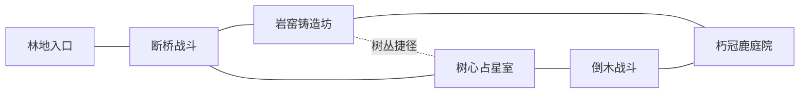

# 坠梦房间与道路设计提案

每层一个维度。每个战斗房和功能房独立搭场景。房间之间使用一间专门显示道路的道路房。支路中间可看见树丛、塌方等障碍，支路尽头是一片漆黑的入口。走进黑口即抵达对应房间。

## 道路房与大地图

| 场景 | 建议做法 |
| --- | --- |
| 进入道路房 | 从战斗房或功能房出门，进入独立的道路房。建议根据从哪间房出来展示可接上的支路，入口方向也能返回来房。 |
| 走路去新房 | 沿所选支路走进尽头的黑口。首次进入照常扣探索，传送后从对应门口看到新房的场景。 |
| 右键地图 | 展开一张可直接用准星选择房间的全层大地图。沿用已经审阅的房间图标与连线，已探索房间和可直达的新房采用不同边框，地图边缘有返回入口。 |
| 右键已探索房间 | 直接传送至所点的房间。建议沿当前通行的已探索路线判断可达范围，回访免费。 |
| 右键相邻新房 | 当前房间与目标之间有一条开放道路时，可以直接传送。使用与走进黑口相同的进房结算、探索扣除和落点。 |
| 遇到塌方或树丛 | 道路房里摆出实体障碍，大地图上对应的连线标出路况。清障或打开树丛之后，两边一起恢复通行。 |
| 战斗和结算 | 战斗中以及战后奖励未处理时，出去的黑口和快移共用同一套锁定。多人首次进房沿用个人扣探索与队友代付。 |

按 **9** 切到地图，右键展开大地图，准星指向房间图块再右键选中。在道路房打开地图时，以玩家刚离开的房间判断相邻关系。道路房的路面和分岔口有环境照明，漆黑的部分集中在每条路的终点。

## 密林的第一段样板路线

例如从断桥赢下第一战后，先出门进入道路房。北支路靠黑口处有打铁声，穿过后到达铸造坊。侧支路靠黑口处有紫晶冷光，穿过后到达占星室。两房之间的树丛开通后，可以直接往返锻造和占星。树丛两头都有正常绕路可达。

## 房间怎么做出区别

| 房间 | 入口看到什么 | 进房后怎么走 |
| --- | --- | --- |
| 铸造坊 | 岩壁洞口漏出炉光。砖烟道贴着岩壁往上伸。 | 进门面对下沉的工作区。炉与砧在低处，服务台设在平台边，从侧边可绕到出口。 |
| 占星室 | 低垂树根围出入口，缝里露出一线冷光。 | 转过厚树根才看到升高的星盘，铜圈和垂吊紫晶构成中心，解读点就在星盘前。 |
| 行商与黑市 | 行商是卸货棚，靠路一面敞开。黑市的入口藏在树根下。 | 行商沿长柜台排实物展台。黑市先下短坡，再绕过一面遮挡，逐件看到展台和价格。 |
| 安全角落 | 石缝里有暖光和能看见火焰的炉火。 | 休息区缩在离过道一步的岩壁凹位，沿墙有座位，保留来时方向和离开后的视线。 |
| 朽冠鹿庭院 | 先见到残破祭门，再看见宽阔的旧庭院。 | 碎柱、树根和墙体留在外围。中心用平坦的铺地和地面纹样划出冲刺带，鹿角扫过的高度留空。实测应覆盖从中心冲刺和斜向冲到边缘。 |

普通战斗房也做场形差异。例如断桥房是一侧高地加浅沟，倒木房是开阔地加边缘掩体。门口留出缓冲，照亮主要移动路线，预警要能从主要机位读到。

## 矿洞如何沿用这套地图

首次进入新房后，来路可能塌方。玩家返回道路房时，可以看见来路的黑口已被落石挡住。另一端查看同一支路时也能看见塌方，大地图连线同步更新。矿车仍能消耗 1 次探索去五房以内的目的地，沿途不算探索。

建议测试普通随机塌方时，至少有一条路线可以继续推进。「闪亮的宝石！」触发四面塌方时，建议先把玩家从来门送出，再封死整个事件房。这样房间仍然被埋掉，玩家需要接受回到上一个节点后重新规划路线。

## 样板验收

先做一间有两三条支路的道路房，接入口、战斗房和一个功能房，再展示其余样板房。集中验证黑口传送、右键展开大地图、回访旧房、进入相邻新房、树丛与塌方的同步和房间结算。层主庭院仍要实测鹿的直线与斜向冲刺。建筑先看每间房进门的第一视角，再看折返和功能操作是否顺手。

试玩使用五间独立房间。准星指到房间时图块放大约 12%，外缘亮起，移开后复原。树丛的实体支路铺苔藓，大地图用深浅两种绿显示未开启与已开启状态。断桥到旧矿口的第一次进房固定触发来路塌方，便于测试封路和绕行。

牛皮纸地图按当前水平朝向立在视线中心。开阔处边长 3.12 格，窄处靠近玩家展开。房间用现有地图的等距网格、直角路径和透明像素图，状态用细描边。房名在瞄准时出现。地图保持在展开的位置，主动收起或切换房间时消失。展开后长按右键不会重复开合。场内展开方式参考用户描述的《驱魔传》，界面使用《坠梦》的房间符号和路况颜色。
