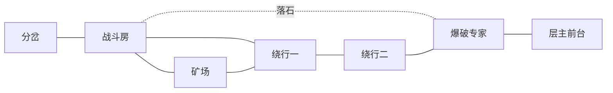

# 坠梦 - FALLEN DREAM

## 抽取怎么改

现在先按普通战或精英战的权重确定稀有度，再按所选类别和职业过滤，最后从剩余装备里出标签。下表来自正式存档的抽取池。一件装备可以有多个标签，职业还会进一步缩小每次的候选池。

| 类别 | 稀有度 | 总数 | 流火 | 夜火 | 噬心 | 渊海 | 白昼梦 |
|---|---|---:|---:|---:|---:|---:|---:|
| 武器 | 常器 | 18 | 3 | 2 | 0 | 2 | 1 |
| 武器 | 异器 | 24 | 1 | 1 | 0 | 0 | 2 |
| 武器 | 精器 | 47 | 6 | 3 | 5 | 4 | 4 |
| 武器 | 秘器 | 46 | 5 | 6 | 6 | 5 | 5 |
| 盔甲 | 常器 | 11 | 2 | 0 | 0 | 2 | 3 |
| 盔甲 | 异器 | 17 | 2 | 1 | 3 | 3 | 2 |
| 盔甲 | 精器 | 25 | 5 | 5 | 3 | 2 | 1 |
| 盔甲 | 秘器 | 24 | 7 | 6 | 7 | 7 | 7 |

135 把可抽武器里，只有 41 把带五大标签中的至少一个。盔甲是 41/77。最明显的断档是噬心武器。普通战后在四档均可抽时，有 74.51% 的概率落到没有噬心武器的两档。渊海武器在异器档也断了一档。常器盔甲没有夜火和噬心。

- **先把能出的词条给足。** 武器、盔甲分别抽，最多四个不同词条。当前稀有度和职业有五大标签的装备时，第一个名额在可用的五大标签里选。整个池缺这类装备时，名额让给其他可用词条。稀有度按原权重抽。
- **把五大标签覆盖率逐步提到 75%。** 按可抽装备的件数统计，一件装备有多个标签也只计一件。复核每档武器和盔甲，再看职业过滤会不会断掉开局选项。
- **先修低阶缺口。** 从已有装备里找适合噬心开局、异器渊海武器以及常器夜火和噬心盔甲的对象。按实际技能标注它能施加、消耗或辅助哪个状态。每个方向在低稀有度就能起步，再靠高阶装备串起连锁。
- **四选一先跑起来。** 选中词条后抽一件，继续用现行稀有度权重。观察低阶能否成形，再复核标签和某件装备的实际抽到概率。

## 战斗和寄存

血条第一行是名字和生命值，第二行是剩余比例。普通、精英、层主分别用 2、3、5 分钟的团队战斗时间。最后 10 秒提示，超时后进入一次狂暴，仍可打完。敌人的攻击属性提高 20%，移动属性提高 15%，每两秒恢复 1% 最大生命。密林的共用脚本伤害按原护甲算法和单击上限结算，朽冠鹿冲刺的位移另有加速。功能房可停留和查看装备。

从状态菜单点击「装备寄存」，会在视野前展开横向面板。左侧两格武器，右侧两格盔甲。放入后可以直接看装备图标和名称，准星停在已占用的槽位上，图标稍微放大。

| 操作 | 显示及行为 |
|---|---|
| 拿着装备右击空格 | 存入对应类别，槽里显示原装备模型 |
| 空手右击有装备的格 | 取出槽里那一件，保留升级、超限和耐久 |
| 装备类型不符，或取出时主手仍有物品 | 给短提示，装备继续留在原处 |

积存的抽取次数用独立按钮。面板仅由本人操作。关闭、换房或掉线后，仍可找回原先寄存的装备。旧版溢出的装备可通过「旧装备」取回。

## 让操作在房间里发生

| 房间或技能 | 改版方向 |
|---|---|
| 战后抽取 | 选标签后实际装备升起，首版沿用原领取时点。后续用光色和尾音区分稀有度，并将两件候选分别摆出。 |
| 铸造坊 | 火槽、铁砧、淬火池分别有位置。施加 α 溅短火花，提升时打出更重的一下。后续用落锤动作连接设备和装备。 |
| 占星室 | 铜环和观测台组成一套陈设，领取后星点落在环上。后续让轨道亮起，最后停在抽中的天赋方位。 |
| 行商、黑市 | 商品上台，靠近看实物和价格。行商用暖色木与铜，黑市用深石、暗紫布边和两侧灯。黑市付款前应看清扣除哪种上限、扣多少。 |
| 安全角落、赌博房、租借商 | 分别用火塘和围坐长凳、三个辨认清楚的转轮窗口、武器架。入口和主活动区留空。 |
| 朽冠鹿 | 开打前已有石柱、枝拱和吊灯。陈设放在边缘和高处，冲刺通道铺平，用地表纹理区分可跑空间。 |
| 武器 | 首轮接入潮痕的前向潮线和退汐的弧形水刃，超限形态用更宽的潮线和三道水刃。下一轮可以从位移的起步、途中残影和落点做起。预警、判定和命中反馈要在多人时依然看得清。 |

[抽取动画时序预览](抽取动画预览.gif)用潮痕贴图和正式演出时长，场景为示意。

位移可沿用玩家当前视角。起步在脚边收起一圈粒子并响起短促音，途中留下两三道逐渐消散的残影，落点用方向性的尘浪标出停在哪里。长位移再考虑可选的客户端镜头拉远，技能结束时回到原视角。

## 第二层演示稿

矿洞第一个分岔能同时看见扬尘的落石支路、工矿灯和旧轨道。演示固定发生一次塌方，让玩家看懂地图和实体道路上同一条路为何消失。

玩家可以多走两间绕路，也可以从矿场付一点探索，坐车去五间以内的爆破专家房，沿途房间保持未探索。爆破专家收 1 梦屑清掉现有落石，后续塌方概率小幅升高。用石尘、断线和路线重新点亮表现变化。多人沿用各人消耗、队友代付的探索规则。凿脉者可用地面裂纹提示掘地切线，逼玩家换位。此段为设计稿，层主模型和战斗数值待审阅。
